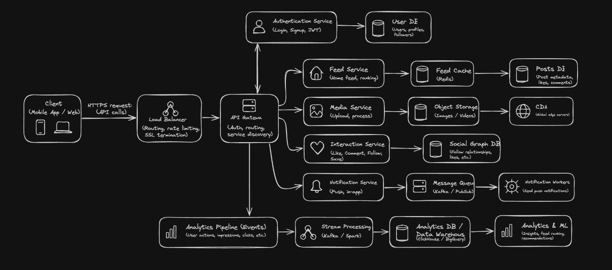

# Insta Clone API

A modular FastAPI starter for a social app. The first feature is account registration,
login, and retrieval of the authenticated user's profile. Users can also follow accounts,
publish text posts, read a chronological feed, interact with posts, and receive in-app notifications.

## Architecture sketch



The diagram shows the larger system this project is working toward. The current code is a
single FastAPI application; its features are modules in that app rather than separate services.
For a walkthrough of the current Redis feed cache, notification flow, and backend design
choices, see the [Redis backend learning guide](docs/redis-backend-learning-guide.md) and
its [editable Excalidraw architecture diagram](docs/redis-backend-architecture.excalidraw).

## Run locally

```bash
python3 -m venv .venv
source .venv/bin/activate
python -m pip install -e .
cp .env.example .env
# Set SECRET_KEY in .env to a long random value before using real accounts.
docker compose up -d redis
uvicorn app.main:app --reload
```

Open `http://127.0.0.1:8000/docs` for the interactive API docs.

Redis caches each user's paginated feed for `FEED_CACHE_TTL_SECONDS` (60 seconds by
default). Post, profile, media, and follow changes invalidate affected feed caches.
Notification events are added to a Redis Stream after the API response and persisted by a
background consumer; if Redis is unavailable while enqueueing, the task logs the failure
and attempts to write the notification directly to the database. Configure Redis with
`REDIS_URL`. Stream delivery is at-least-once: the consumer acknowledges events after the
database commit, so an interruption between those steps can result in a duplicate notification.

## API endpoints

- `POST /api/v1/auth/register` — create an account
- `POST /api/v1/auth/login` — exchange email and password for a bearer token
- `GET /api/v1/auth/me` — return the current user's profile (send `Authorization: Bearer <token>`)
- `PATCH /api/v1/users/me` — update your username or display name (authentication required)
- `POST /api/v1/posts` — publish a text post (authentication required)
- `PATCH /api/v1/posts/{post_id}` — edit your post text (authentication required)
- `DELETE /api/v1/posts/{post_id}` — delete your post (authentication required)
- `POST /api/v1/posts/{post_id}/media` — upload an image to your post (authentication required; JPEG, PNG, or WebP, up to 10 MB)
- `DELETE /api/v1/posts/{post_id}/media/{media_id}` — remove an image from your post (authentication required)
- `GET /api/v1/notifications` — list your notifications (authentication required; supports `unread_only`, `limit`, and `offset`)
- `PATCH /api/v1/notifications/{notification_id}/read` — mark one notification as read (authentication required)
- `POST /api/v1/analytics/events` — record an authenticated user event such as `post_viewed`
- `GET /api/v1/posts/feed` — list your posts and posts from accounts you follow (authentication required)
- `GET /api/v1/posts/users/{username}` — list a user's public posts
- `POST /api/v1/users/{username}/follow` — follow a user (authentication required)
- `DELETE /api/v1/users/{username}/follow` — unfollow a user (authentication required)
- `POST /api/v1/posts/{post_id}/likes` — like a post (authentication required)
- `DELETE /api/v1/posts/{post_id}/likes` — remove your like (authentication required)
- `GET /api/v1/posts/{post_id}/likes/count` — get a post's like count
- `POST /api/v1/posts/{post_id}/comments` — add a comment (authentication required)
- `GET /api/v1/posts/{post_id}/comments` — list a post's comments
- `DELETE /api/v1/posts/{post_id}/comments/{comment_id}` — delete your comment (authentication required)
- `GET /health` — health check

The default database is a local SQLite file. Set `DATABASE_URL` to use PostgreSQL. Tables
are created automatically for local development; add Alembic migrations before deploying.
Uploaded images are stored in `MEDIA_DIR` (default `uploads/`) and served from `/media/`.
