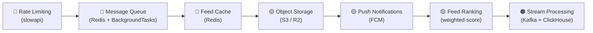

# Architecture Gaps — What's Missing

> [!NOTE]
> Your monolith already implements all the **business logic**. What's missing are the **infrastructure & scalability layers** shown in the diagram.

---

## ✅ Already Built

| Diagram Component | Your Implementation |
|---|---|
| Authentication Service (Login, Signup, JWT) | `app/api/routes/auth.py` + `app/core/security.py` |
| User DB (Users, profiles, followers) | `app/models/user.py` + `app/models/follow.py` |
| Feed Service (Home feed) | `GET /posts/feed` — chronological SQL query |
| Posts DB (Post metadata, likes, comments) | `app/models/post.py`, `like.py`, `comment.py` |
| Media Service (Upload) | `app/api/routes/media.py` — local file storage |
| Interaction Service (Like, Comment, Follow) | `app/api/routes/interactions.py` + `follows.py` |
| Notification Service (in-app) | `app/services/notifications.py` + `notifications.py` route |
| Analytics Pipeline (event capture) | `app/api/routes/analytics.py` + `app/services/analytics.py` |

---

## ❌ Fundamental Missing Pieces

### ✅ 1. Feed Cache (Redis)
**What the diagram shows:** Feed Service → Feed Cache (Redis) → Posts DB

**What you have:** `GET /posts/feed` uses a Redis cache with a TTL and falls back to SQL on a
cache miss or Redis error. Post, profile, media, and follow changes invalidate affected
feed caches.

**Remaining consideration:** The cache is cache-aside, not a pre-built fan-out-on-write
feed. At larger scale, consider indexing cache keys to make invalidation more efficient.

### ✅ 2. Notification Queue (Redis Streams)
**What the diagram shows:** Notification Service → Message Queue → Notification Workers

**What you have:** Like, comment, and follow actions commit to SQL, then schedule a
notification event through FastAPI `BackgroundTasks` into a Redis Stream. A consumer writes
the notification record to SQL and acknowledges the event after the commit.

**Why this decision:** Notification creation is secondary to the user's action. Queueing it
keeps notification persistence out of the request's critical path, buffers events for
retry when processing fails, and reuses Redis already used by the feed cache. The action
itself remains synchronous and authoritative in SQL.

**Trade-offs / next step:** The current design is at-least-once and has a gap between the
action commit and event enqueue; a process failure in that gap can lose the notification.
Retries may also create duplicates. For stronger guarantees or independent scaling, use a
transactional outbox and a separately deployed worker.

---

### 🔴 3. Push Notifications (Notification Workers)
**What the diagram shows:** Notification Workers → Send push notifications

**What you have:** Only **in-app** notifications (stored in DB, fetched by polling). There's no way to alert a user's phone/browser.

**Why it matters:** Real Instagram doesn't make you refresh the app — it pushes alerts to your device. This requires:
- **FCM** (Firebase Cloud Messaging) for Android/iOS
- **Web Push** for browsers
- Device token storage per user

**What to build:**
- Add `device_token` field to `User` model
- `POST /users/me/device-token` endpoint
- Notification worker that calls FCM API when a notification is created

---

### 🟡 4. Object Storage + CDN
**What the diagram shows:** Media Service → Object Storage (S3) → CDN (global edge servers)

**What you have:** Media is saved to a **local `uploads/` folder** and served directly by FastAPI's `StaticFiles`:
```python
# In config.py
media_dir: str = "uploads"
# In main.py
app.mount("/media", StaticFiles(directory=settings.media_dir))
```

**Why it matters:** Local disk storage doesn't work when you have multiple servers, and FastAPI is not a file server. S3 + CDN means files are stored durably and served from edge nodes close to the user.

**What to build:**
- Replace local file write with `boto3` S3 upload
- Store S3 URL in `MediaAsset.file_name` instead of local path
- Add CloudFront / Cloudflare CDN in front of S3

---

### 🟡 5. Rate Limiting (API Gateway / Load Balancer)
**What the diagram shows:** Load Balancer → rate limiting

**What you have:** No rate limiting at all. Any client can hammer your endpoints unlimited times.

**Why it matters:** Without rate limiting, your app is open to abuse — spam registrations, brute-force login attacks, API scraping.

**What to build:**
- `slowapi` library (Redis-backed rate limiter for FastAPI)
- Apply stricter limits on auth endpoints (`POST /auth/login`, `POST /auth/register`)
- Looser limits on read endpoints

---

### 🟡 6. Feed Ranking (Analytics & ML)
**What the diagram shows:** Analytics & ML → Insights, feed ranking, recommendations

**What you have:** Feed is purely **chronological** (`ORDER BY created_at DESC`). No ranking, no recommendations.

**Why it matters:** Instagram's "For You" feed is ranked by engagement probability. Your analytics events (`post_viewed`, etc.) are being captured but never used for anything.

**What to build:**
- Score posts by recency + like count + comment count + follow closeness
- Use captured analytics events to weight content
- Start simple: a weighted SQL score, then graduate to an ML model

---

### 🟠 7. Stream Processing for Analytics
**What the diagram shows:** Analytics Pipeline → Stream Processing (Kafka/Spark) → Analytics DB (ClickHouse/BigQuery)

**What you have:** Analytics events are written directly to the same SQLite DB as everything else. No processing pipeline.

**Why it matters:** At scale, analytics queries (aggregations, funnels) would lock up your main DB. A separate analytics warehouse processes events async.

**What to build:**
- Publish events to Kafka instead of writing to DB directly
- A Spark/Flink job consumes and aggregates them
- Results land in ClickHouse (realtime) or BigQuery (batch)

---

## 🗺️ Recommended Learning Order



> [!TIP]
> **Start with Redis** — it unlocks both the Message Queue and Feed Cache in one setup. It's also the single biggest leap from "tutorial backend" to "production backend" thinking.
