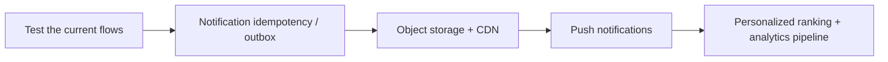

# Architecture Gaps — What's Missing

> [!NOTE]
> This repository is a modular monolith with working API features and several supporting
> infrastructure components. The diagram shows a larger target architecture; the sections
> below distinguish what is implemented from what remains a possible extension.

---

## ✅ Already Built

| Diagram Component | Your Implementation |
|---|---|
| Authentication Service (Login, Signup, JWT) | `app/api/routes/auth.py` + `app/core/security.py` |
| User DB (Users, profiles, followers) | `app/models/user.py` + `app/models/follow.py` |
| Feed Service (Home feed) | `GET /posts/feed` — engagement and recency ranked SQL query |
| Posts DB (Post metadata, likes, comments) | `app/models/post.py`, `like.py`, `comment.py` |
| Media Service (Upload) | `app/api/routes/media.py` — local file storage |
| Interaction Service (Like, Comment, Follow) | `app/api/routes/interactions.py` + `follows.py` |
| Notification Service (in-app) | `app/services/notifications.py` + `notifications.py` route |
| Analytics Pipeline (event capture) | `app/api/routes/analytics.py` + `app/services/analytics.py` |

---

## Architecture Components and Remaining Gaps

### ✅ 1. Feed Cache (Redis)
**What the diagram shows:** Feed Service → Feed Cache (Redis) → Posts DB

**What you have:** `GET /posts/feed` uses a Redis cache with a TTL and falls back to SQL on a
cache miss or Redis error. Versioned cache keys let post, profile, media, engagement, and
follow changes invalidate feed pages without deleting keys for every follower.

**Remaining consideration:** Author changes now have constant Redis write work regardless
of follower count. Feed reads resolve the followee list and fetch its author versions via
one Redis `MGET`, so read-side version work grows with the number of followed accounts.
If Redis cannot provide version data, the request bypasses the cache. Version counters can
be lost when Redis data is flushed or restarted without persistence; old cache entries then
remain addressable until their TTL expires. The cache is still cache-aside, not a pre-built
fan-out-on-write feed.

### ✅ 2. Notification Queue (Redis Streams)
**What the diagram shows:** Notification Service → Message Queue → Notification Workers

**What you have:** Like, comment, and follow actions commit to SQL, then schedule a
notification event through FastAPI `BackgroundTasks` into a Redis Stream. A consumer writes
the notification record to SQL and acknowledges the event after the commit.

**Why this decision:** Notification creation is secondary to the user's action. Queueing it
keeps notification persistence out of the request's critical path, buffers events for
retry when processing fails, and reuses Redis already used by the feed cache. The action
itself remains synchronous and authoritative in SQL.

**Trade-offs / next step:** The current design is at-least-once and has a gap between the
action commit and event enqueue; a process failure in that gap can lose the notification.
Retries may also create duplicates. For stronger guarantees or independent scaling, use a
transactional outbox and a separately deployed worker.

---

### 🔴 3. Push Notifications (Notification Workers)
**What the diagram shows:** Notification Workers → Send push notifications

**What you have:** Only **in-app** notifications (stored in DB, fetched by polling). There's no way to alert a user's phone/browser.

**Why it matters:** Real Instagram doesn't make you refresh the app — it pushes alerts to your device. This requires:
- **FCM** (Firebase Cloud Messaging) for Android/iOS
- **Web Push** for browsers
- Device token storage per user

**What to build:**
- Add `device_token` field to `User` model
- `POST /users/me/device-token` endpoint
- Notification worker that calls FCM API when a notification is created

---

### 🟡 4. Object Storage + CDN
**What the diagram shows:** Media Service → Object Storage (S3) → CDN (global edge servers)

**What you have:** Media is saved to a **local `uploads/` folder** and served directly by FastAPI's `StaticFiles`:
```python
# In config.py
media_dir: str = "uploads"
# In main.py
app.mount("/media", StaticFiles(directory=settings.media_dir))
```

**Why it matters:** Local disk storage doesn't work when you have multiple servers, and FastAPI is not a file server. S3 + CDN means files are stored durably and served from edge nodes close to the user.

**What to build:**
- Replace local file write with `boto3` S3 upload
- Store S3 URL in `MediaAsset.file_name` instead of local path
- Add CloudFront / Cloudflare CDN in front of S3

---

### ✅ 5. Rate Limiting (application-level)
**What the diagram shows:** Load Balancer → rate limiting

**What you have:** SlowAPI applies Redis-backed, per-client-IP limits: 100 requests per
minute by default, 5 login attempts per minute, and 3 registrations per hour. Limits can be
configured with `DEFAULT_RATE_LIMIT`, `LOGIN_RATE_LIMIT`, and `REGISTER_RATE_LIMIT`.

**Scope note:** This is application-level rate limiting, not a separate API gateway or
load balancer. When deployed behind a proxy, configure trusted proxy handling so client IPs
are identified correctly.

### ✅ Database schema migrations (Alembic)
**What you have:** An initial schema migration and an Alembic environment configured to
read the application's `DATABASE_URL`. `alembic upgrade head` applies the schema; use
`alembic revision --autogenerate -m "describe the change"` to prepare a migration after
changing models, then review that file before applying it.

**Deployment note:** Set `AUTO_CREATE_TABLES=false` so the app does not create schema
automatically at startup; apply Alembic migrations as a deployment step instead.

---

### 🟡 6. Advanced Feed Ranking (Analytics & ML)
**What the diagram shows:** Analytics & ML → Insights, feed ranking, recommendations

**What you have:** The home feed uses a basic weighted score: 2 points per like, 3 per
comment, plus a 10-point bonus for posts newer than 24 hours or a 5-point bonus for posts
newer than 7 days. Ties are chronological. This score is not personalized and does not
include analytics events.

**Why it matters:** Instagram's "For You" feed is ranked by engagement probability. Your analytics events (`post_viewed`, etc.) are being captured but never used for anything.

**What to build:**
- Add personalization using followed-account affinity and user interactions
- Use captured analytics events to tune ranking
- Evaluate ranking quality and add recommendations

---

### 🟠 7. Stream Processing for Analytics
**What the diagram shows:** Analytics Pipeline → Stream Processing (Kafka/Spark) → Analytics DB (ClickHouse/BigQuery)

**What you have:** Analytics events are written directly to the configured application SQL
database (SQLite by default, PostgreSQL in the Docker setup). There is no separate
processing pipeline or analytics store.

**Why it matters:** At scale, analytics queries (aggregations, funnels) would lock up your main DB. A separate analytics warehouse processes events async.

**What to build:**
- Publish events to Kafka instead of writing to DB directly
- A Spark/Flink job consumes and aggregates them
- Results land in ClickHouse (realtime) or BigQuery (batch)

---

## Suggested learning steps



> [!TIP]
> Alembic migrations, Redis feed caching, Redis Streams, and application rate limiting
> already exist. Add tests around these behaviors before extending the system with more
> infrastructure; review and apply migrations as part of schema changes.
