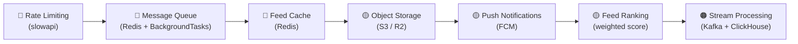

# Architecture Gaps — What's Missing

> [!NOTE]
> Your monolith already implements all the **business logic**. What's missing are the **infrastructure & scalability layers** shown in the diagram.

---

## ✅ Already Built

| Diagram Component | Your Implementation |
|---|---|
| Authentication Service (Login, Signup, JWT) | `app/api/routes/auth.py` + `app/core/security.py` |
| User DB (Users, profiles, followers) | `app/models/user.py` + `app/models/follow.py` |
| Feed Service (Home feed) | `GET /posts/feed` — chronological SQL query |
| Posts DB (Post metadata, likes, comments) | `app/models/post.py`, `like.py`, `comment.py` |
| Media Service (Upload) | `app/api/routes/media.py` — local file storage |
| Interaction Service (Like, Comment, Follow) | `app/api/routes/interactions.py` + `follows.py` |
| Notification Service (in-app) | `app/services/notifications.py` + `notifications.py` route |
| Analytics Pipeline (event capture) | `app/api/routes/analytics.py` + `app/services/analytics.py` |

---

## ❌ Fundamental Missing Pieces

### 🔴 1. Feed Cache (Redis)
**What the diagram shows:** Feed Service → Feed Cache (Redis) → Posts DB

**What you have:** Every `GET /posts/feed` hits the database with a fresh SQL query — no caching at all.

**Why it matters:** Feed is the most-read endpoint in any social app. Without a cache, every request is a DB hit. Redis lets you pre-build and store feeds in memory (microsecond reads vs millisecond DB queries).

**What to build:**
- Cache the feed result per user in Redis with a TTL
- Invalidate/update the cache when a followed user posts
- This is a **fan-out-on-write** pattern (Instagram's actual approach)

---

### 🔴 2. Message Queue (Kafka / Redis Pub-Sub)
**What the diagram shows:** Notification Service → Message Queue → Notification Workers

**What you have:** Notifications are written **synchronously** inside the same DB transaction as the action:
```python
# In interactions.py — notification is written inline, blocking the response
db.add(Notification(...))
db.commit()
```

**Why it matters:** If notification delivery fails or is slow, it blocks the user's like/comment action. A queue decouples them — the action completes instantly, notifications are processed async in the background.

**What to build:**
- Publish events (like, follow, comment) to a Redis queue or Kafka topic
- A background worker consumes the queue and creates notifications
- FastAPI has `BackgroundTasks` as a simple first step before full Kafka

---

### 🔴 3. Push Notifications (Notification Workers)
**What the diagram shows:** Notification Workers → Send push notifications

**What you have:** Only **in-app** notifications (stored in DB, fetched by polling). There's no way to alert a user's phone/browser.

**Why it matters:** Real Instagram doesn't make you refresh the app — it pushes alerts to your device. This requires:
- **FCM** (Firebase Cloud Messaging) for Android/iOS
- **Web Push** for browsers
- Device token storage per user

**What to build:**
- Add `device_token` field to `User` model
- `POST /users/me/device-token` endpoint
- Notification worker that calls FCM API when a notification is created

---

### 🟡 4. Object Storage + CDN
**What the diagram shows:** Media Service → Object Storage (S3) → CDN (global edge servers)

**What you have:** Media is saved to a **local `uploads/` folder** and served directly by FastAPI's `StaticFiles`:
```python
# In config.py
media_dir: str = "uploads"
# In main.py
app.mount("/media", StaticFiles(directory=settings.media_dir))
```

**Why it matters:** Local disk storage doesn't work when you have multiple servers, and FastAPI is not a file server. S3 + CDN means files are stored durably and served from edge nodes close to the user.

**What to build:**
- Replace local file write with `boto3` S3 upload
- Store S3 URL in `MediaAsset.file_name` instead of local path
- Add CloudFront / Cloudflare CDN in front of S3

---

### 🟡 5. Rate Limiting (API Gateway / Load Balancer)
**What the diagram shows:** Load Balancer → rate limiting

**What you have:** No rate limiting at all. Any client can hammer your endpoints unlimited times.

**Why it matters:** Without rate limiting, your app is open to abuse — spam registrations, brute-force login attacks, API scraping.

**What to build:**
- `slowapi` library (Redis-backed rate limiter for FastAPI)
- Apply stricter limits on auth endpoints (`POST /auth/login`, `POST /auth/register`)
- Looser limits on read endpoints

---

### 🟡 6. Feed Ranking (Analytics & ML)
**What the diagram shows:** Analytics & ML → Insights, feed ranking, recommendations

**What you have:** Feed is purely **chronological** (`ORDER BY created_at DESC`). No ranking, no recommendations.

**Why it matters:** Instagram's "For You" feed is ranked by engagement probability. Your analytics events (`post_viewed`, etc.) are being captured but never used for anything.

**What to build:**
- Score posts by recency + like count + comment count + follow closeness
- Use captured analytics events to weight content
- Start simple: a weighted SQL score, then graduate to an ML model

---

### 🟠 7. Stream Processing for Analytics
**What the diagram shows:** Analytics Pipeline → Stream Processing (Kafka/Spark) → Analytics DB (ClickHouse/BigQuery)

**What you have:** Analytics events are written directly to the same SQLite DB as everything else. No processing pipeline.

**Why it matters:** At scale, analytics queries (aggregations, funnels) would lock up your main DB. A separate analytics warehouse processes events async.

**What to build:**
- Publish events to Kafka instead of writing to DB directly
- A Spark/Flink job consumes and aggregates them
- Results land in ClickHouse (realtime) or BigQuery (batch)

---

## 🗺️ Recommended Learning Order



> [!TIP]
> **Start with Redis** — it unlocks both the Message Queue and Feed Cache in one setup. It's also the single biggest leap from "tutorial backend" to "production backend" thinking.
