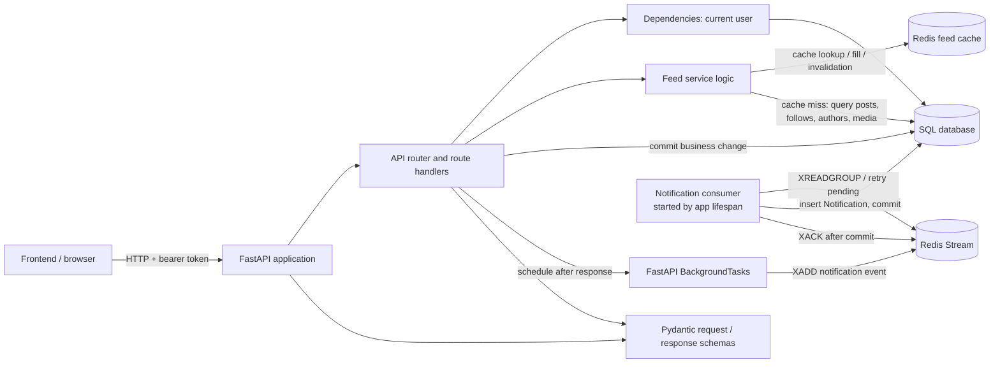
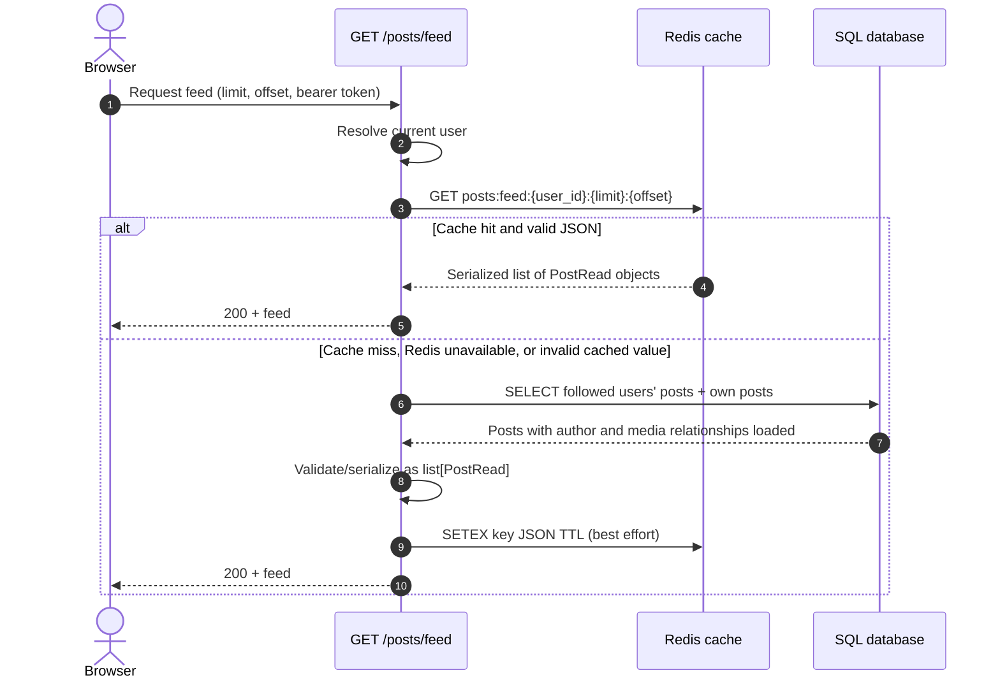
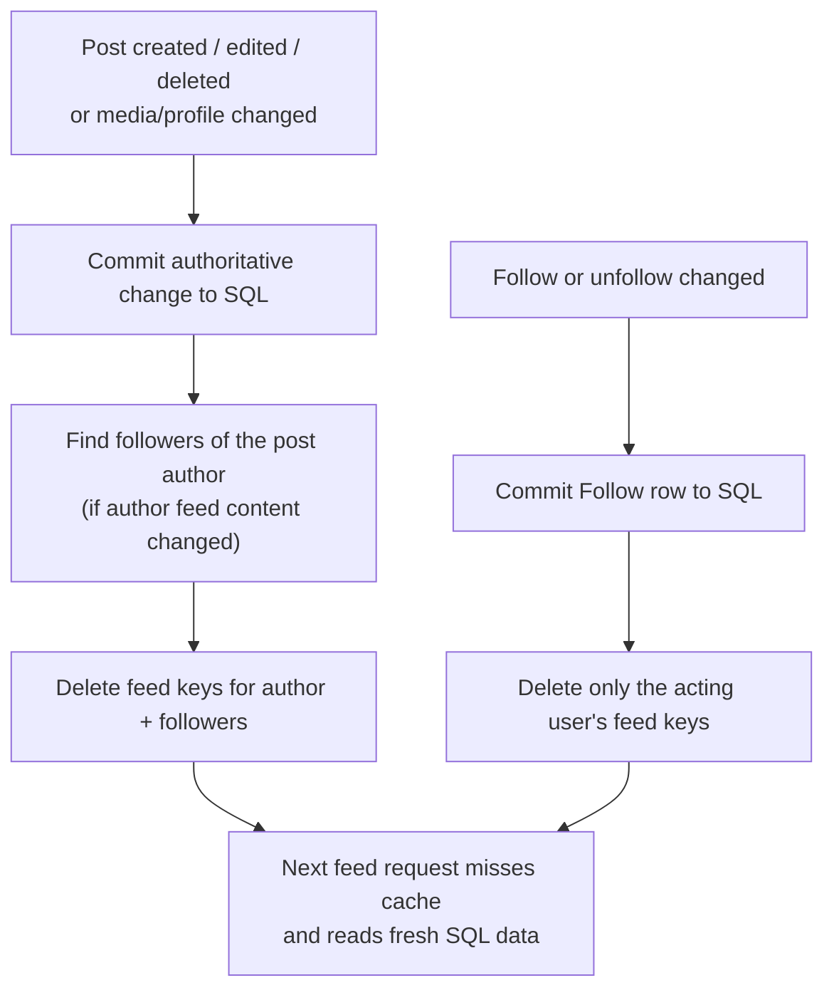
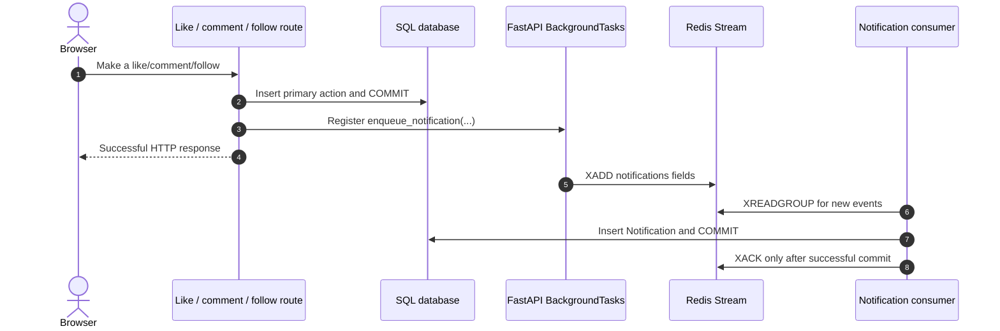

# Redis in this app: a backend learning guide

This guide walks through the feed cache and notification pipeline in this project. It is
written for someone who already knows how to build a frontend and wants to understand what
happens after an HTTP request reaches a backend.

## Start with the architecture

Open [redis-backend-architecture.excalidraw](./redis-backend-architecture.excalidraw) in
[Excalidraw](https://excalidraw.com) to explore the editable architecture sketch.

The app is still a **modular monolith**: one FastAPI application process owns the HTTP
routes and starts the notification consumer. PostgreSQL (or local SQLite) remains the
source of truth. Redis is an auxiliary system for fast, disposable feed results and queued
notification events.



### Map this to frontend concepts

| Backend concept | Rough frontend analogy | In this project |
|---|---|---|
| Route handler | Controller for one endpoint | `app/api/routes/posts.py` |
| Pydantic schema | Validated API DTO / contract | `app/schemas/post.py` |
| SQLAlchemy model | ORM entity mapped to a table | `app/models/post.py` |
| `Session` | Unit of work / database transaction boundary | `app/core/database.py` |
| Dependency (`Depends`) | Request-scoped injected service | `get_db`, `get_current_user` |
| Redis cache | Shared, short-lived derived state | `app/core/feed_cache.py` |
| Redis Stream | Durable-ish event log / message broker | `app/services/notifications.py` |
| Lifespan | Process startup and shutdown hooks | `app/main.py` |

These are analogies, not exact equivalences. For example, the database `Session` is not a
global application store: it is created for a request, used for a transaction, and closed
afterward.

## Feed read: cache-aside

The feed uses a common pattern called **cache-aside**. The API checks the cache itself,
falls back to the database when the entry is missing, then fills the cache with the
database result.



### Why the cache key has these parts

`feed_cache_key()` in [app/core/feed_cache.py](../app/core/feed_cache.py) builds a key
from the current user's ID, page size, and offset:

```text
posts:feed:42:20:0
```

The user ID prevents one person's personalized feed from being returned to another person.
The pagination values prevent page 1 being mistaken for page 2. This is the cache equivalent
of including every input that can change a function's output.

The cached value is JSON produced from `PostRead`, not raw ORM objects. ORM objects are
connected to a live database session and can include relationships or internal state that
should not be stored in Redis. A response schema is a stable API-shaped representation.
When reading, Pydantic validates the JSON; invalid data is discarded and the database is
queried instead.

### Why Redis failures do not fail the feed

The feed is useful without a cache, just slower. `get_cached_feed()` and `cache_feed()`
therefore log Redis errors and let the database path continue. The cache has a 60-second
default TTL, configurable with `FEED_CACHE_TTL_SECONDS`; TTL is a safety net against stale
entries even if an invalidation is missed.

Redis is **not** the source of truth for posts. Losing the cache only costs performance.

## Feed writes: invalidate derived data

Caching makes reads cheaper, but introduces a consistency question: how does the app stop
serving an old feed after a post or follow changes?



For author content changes, `invalidate_author_feeds()` finds that author's followers, then
clears feed keys for those users and the author. A follow/unfollow only changes the acting
user's membership, so only that user's feed needs invalidation.

This uses **invalidation**, not an attempt to edit cached feed JSON in place. Updating
serialized pages is complex: a new post may shift every offset page, and the same post can
appear in many users' feeds. Deleting cache entries lets the existing SQL query rebuild the
correct page on demand.

Redis key scans here use `SCAN` through `scan_iter`, not the blocking `KEYS` command. The
current implementation still performs a scan per affected user, which is straightforward
for a learning project and modest scale. At larger scale, consider versioned feed keys,
sets of keys indexed by user, or a cache design that avoids broad key scans.

## Notifications: write now, notify later

Likes, comments, and follows are the primary user actions. The app commits those changes
to SQL before scheduling notification work. It should not hold the user's request open
while a separate notification row is written.



`BackgroundTasks` and the Redis Stream solve different parts of the problem:

1. **FastAPI `BackgroundTasks`** defers the enqueue callback until after the HTTP response.
   The route code stays simple and the client does not wait for notification creation.
2. **Redis Streams** hold events after `XADD`, track consumer-group delivery, and allow the
   worker to retry pending messages.
3. **The notification table** is still the durable, queryable record used by
   `GET /notifications`.

The stream fields are intentionally small identifiers and event data:

```text
recipient_id, actor_id, event_type, post_id
```

The worker creates a fresh SQLAlchemy session for each notification via
`SessionLocal()`. It commits the row, then acknowledges the stream entry. If the database
write fails, the worker logs the error and leaves the entry pending; a later
`XAUTOCLAIM` can take over entries idle for at least 30 seconds.

## Reliability boundaries to understand

This is a useful starter design, but it does not promise exactly-once processing:

- If the app process stops after the primary action commits but before the FastAPI
  background callback runs `XADD`, that notification event can be lost.
- If the SQL commit succeeds but the worker stops before `XACK`, the stream entry can be
  processed again, creating a duplicate notification.
- If Redis enqueue fails, the callback tries a direct SQL write and logs errors if that
  fallback also fails. This keeps the failure visible, but a notification can still be lost.
- The Redis Stream has no trimming/retention policy yet, so it can grow indefinitely.
- The worker runs inside each FastAPI process. Consumer groups distribute entries among
  workers, but production deployments need deliberate lifecycle, monitoring, and scaling
  decisions.

For stronger delivery guarantees, a common next step is the **transactional outbox**:
write the business row and an outbox event in the same SQL transaction, then have a separate
worker publish/process outbox rows and mark them delivered. That closes the gap between
committing the like/follow/comment and publishing its event. Idempotency keys or unique
constraints can prevent duplicate notification rows when a message is retried.

## Code tour

Read these files in this order:

1. [app/api/routes/posts.py](../app/api/routes/posts.py) — the feed endpoint and the point
   where cache-aside logic fits around the SQL query.
2. [app/core/feed_cache.py](../app/core/feed_cache.py) — key construction, Redis calls, and
   cache invalidation.
3. [app/schemas/post.py](../app/schemas/post.py) — the response shape cached and returned
   to clients.
4. [app/api/routes/interactions.py](../app/api/routes/interactions.py) and
   [app/api/routes/follows.py](../app/api/routes/follows.py) — commit the primary action,
   then schedule notification work.
5. [app/services/notifications.py](../app/services/notifications.py) — schedule and enqueue
   events, plus the SQL persistence function.
6. [app/services/notification_worker.py](../app/services/notification_worker.py) — consume,
   persist, acknowledge, and retry stream entries.
7. [app/main.py](../app/main.py) — start and stop the background consumer with the
   application lifecycle.
8. [app/core/database.py](../app/core/database.py) and
   [app/core/redis.py](../app/core/redis.py) — see how shared clients and per-operation
   database sessions are created.

## A frontend-to-backend request trace

For a frontend call such as:

```ts
await fetch("/api/v1/posts/feed?limit=20&offset=0", {
  headers: { Authorization: `Bearer ${token}` },
});
```

the backend flow is:

1. FastAPI matches `/api/v1/posts/feed` to `read_feed`.
2. `get_current_user` validates the bearer token and loads the user from SQL.
3. `get_db` provides a SQLAlchemy session to the route.
4. `read_feed` builds a cache key from user ID and pagination.
5. A cache hit is validated against `PostRead`; otherwise SQLAlchemy runs the feed query.
6. Pydantic shapes the result, Redis gets a TTL-bound copy, and FastAPI serializes the HTTP
   response.

The key backend shift is that a route is not just a function returning JSON. It coordinates
validation, identity, transaction scope, domain rules, persistence, caches, and response
contracts. Keeping those responsibilities visible is what makes this code useful to study.

## Try these learning exercises

1. Add a test that calls the feed twice and asserts the second call does not execute the
   SQL feed query.
2. Add a cache invalidation test for follow and unfollow. Verify the user's feed changes
   after each action.
3. Add a `FEED_CACHE_TTL_SECONDS` setting override in a test and inspect the Redis TTL.
4. Add an idempotency strategy for notification events and test that replaying one Stream
   entry does not create two notification rows.
5. Sketch a transactional outbox table and compare its failure modes with
   `BackgroundTasks -> Redis Stream`.

For local development, start Redis with `docker compose up -d redis`; the app reads
`REDIS_URL` and `FEED_CACHE_TTL_SECONDS` from its environment.
